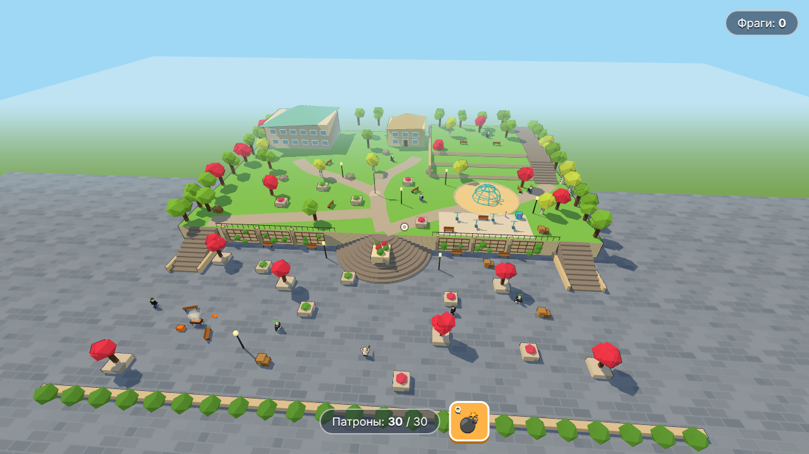
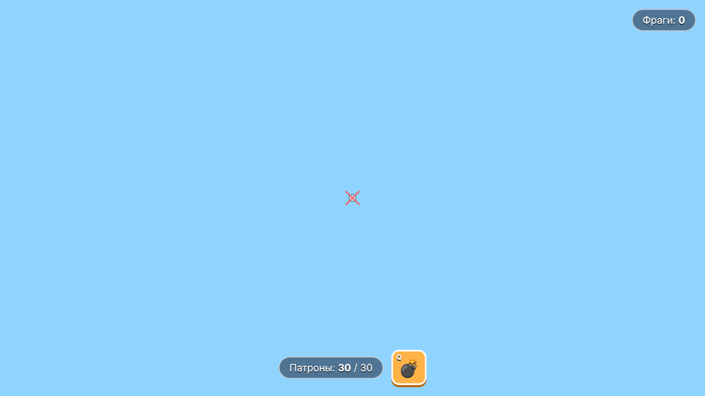

# Скуфы против зумеров

Браузерный мемный шутер от третьего лица в духе Battlefield Heroes. Свой low-poly стиль, весь арт собран из примитивов прямо в коде.





## Запуск

```bash
npm i
npm run dev
```

Открой адрес, который покажет Vite (обычно http://localhost:5173), и кликни по экрану.

## Управление

| Клавиша | Действие |
| --- | --- |
| WASD | бег |
| Пробел | прыжок |
| Мышь | камера |
| ЛКМ | стрельба |
| R | перезарядка |
| Q | граната |
| Esc | пауза |

## Что внутри

- `src/world.js` — карта «Парк поколений»: нижняя площадь, подпорная стена, полукруглая лестница, газон с дорожками, террасы, игровая площадка, тренажёры, здания, флаг, мангал; граф путей для ботов
- `src/heroes.js` — шесть героев (Палыч, Саныч, Свайп, Хайп, Дед Инсайд, Ночной Админ): пропорции, лица, аксессуары
- `src/character.js` — сборка героя: голова-вожак с нарисованным лицом, тело, анимации бега, прыжка и прицеливания
- `src/player.js` — управление, камера из-за плеча, тряска камеры
- `src/physics.js` — простая физика: гравитация, столкновения с AABB, подъём по ступеням
- `src/bots.js` — боты-мишени из лагеря соперника: ходят по карте через лестницы, получают урон, отлетают и респавнятся
- `src/grenade.js` — граната с отскоками и фитилём
- `src/effects.js` — взрыв (огненный шар, ударное кольцо, дым, обломки, «БАХ!»), трассеры, искры, цифры урона
